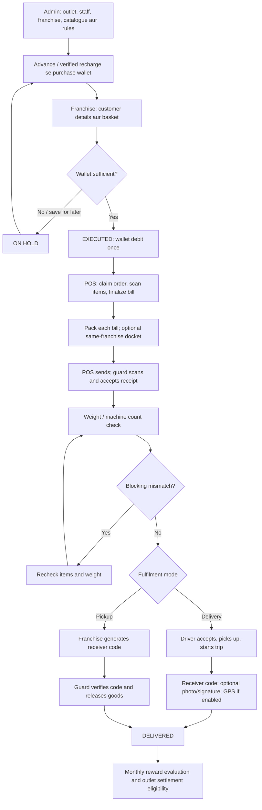

# E-Franchise — modules aur complete workflow

Updated: 17 September 2026.

Application ke existing dashboards ke saath **Operations** link add hua hai. Har role ko uska apna Work Desk dikhta hai. **Account** se password change hota hai.

## 1. Overall flow

## 2. Admin module

**Dashboard:** `/admin/dashboard` · **Work Desk:** `/workspace`

1. Network tab mein outlet banayein; POS, Guard aur Delivery staff ko outlet assign karein.
2. Franchise account banayein: owner, shop, mobile/login ID, initial password, outlet, address, opening advance.
3. Advance ka configured percentage purchase wallet mein credit hota hai; default 75%.
4. Catalogue mein single product ya CSV/XLSX import karein. Existing SKU ka import master update karta hai.
5. GST-inclusive price, weight, pack, commission aur eligible target items configure karein.
6. Commission rules aur dated promotions save karein. Product commission department commission se pehle apply hota hai.
7. Delivery charges, free quota, weight tolerance, blocking, advance allocation aur docket limits set karein.
8. Work Desk mein target programs/slabs banayein. Rule change ke liye naya program banakar purana deactivate karein; existing reward ledger entries rewrite nahi hote.
9. Coordinates/state code set karein. Configured OSRM provider se driving distance calculate/save kar sakte hain. New orders saved route distance use karte hain.
10. Held order execute/cancel karein. Billed order ka normal cancellation blocked hai.
11. Staff deactivate karne par uski previous sessions invalid ho jaati hain.

**Operational exceptions:** failed delivery reopen, same-outlet active driver ko reassign, ya dispatched delivery ko reason/evidence ke saath force close. Admin override audit trail mein alag record hota hai.

## 3. Franchise ordering and wallets

Home dashboard month-to-date delivered sales / elapsed calendar days (IST) × month days se projected monthly sales aur commission dikhata hai. Active monthly programs ki projected eligible sales par reward calculate hota hai. Nearest upcoming slab comparison same product mix/commission rate assume karta hai, aur extra eligible sales, projected earning vs slab earning dikhata hai. Ye estimates wallet credits nahi hain; zero sales par commission comparison unavailable rehta hai.

**Dashboard:** `/franchise/home`

1. Catalogue search karein; products/pack sizes cart mein add karein.
2. Actual buyer ka naam aur mobile enter karein.
3. Franchise pickup ya delivery-to-franchise choose karein. Delivery customer ke ghar nahi, franchise ke registered address par hoti hai.
4. Basket, commission, customer total aur estimated purchase-wallet debit review karein.
5. **Use wallet & execute:** sufficient funds hon to debit aur order execution same database transaction mein hote hain. Otherwise order held rehta hai.
6. **Save on hold:** wallet debit nahi hota. Later wallet fund karke execute karein.
7. Bill create hone ke baad customer invoice print/save PDF ya WhatsApp sharing link se manually share karein.
8. Dispatch status aur latest updates dekhein. Browser approximately 15 seconds par authorized order events poll karta hai; refresh link data refresh karta hai.

### Money example

Assume merchandise ₹1,000, commission ₹80, delivery cost ₹30:

| Delivery charge borne by | Customer invoice | Purchase-wallet debit | Outlet merchandise payable |
|---|---:|---:|---:|
| Customer | ₹1,030 | ₹950 | ₹920 |
| Franchisee | ₹1,000 | ₹950 | ₹920 |
| Business | ₹1,000 | ₹920 | ₹920 |

Product commission franchise margin hai: customer receipt aur purchase cost ka difference. Monthly target reward alag earnings wallet mein credit hota hai. Earnings wallet se purchase wallet transfer available hai.

Existing historical orders ka quoted total/debit migration ke waqt preserve kiya jaata hai. Naye orders updated pricing breakdown store karte hain.

### Manual wallet flow

Admin verified advance / credit / debit with reason → ledger entry → updated balance. Browser request keys duplicate advance/adjustment/transfer submission ko repeat nahi karte. Wallet ledgers update/delete se protected hain; corrections compensating entries se honi chahiye.

### Online top-up flow

Franchise Operations → amount → Razorpay order → hosted checkout → signed captured-payment webhook → amount/currency/order validation → one wallet credit.

- Browser success message alone wallet credit nahi karta.
- Duplicate webhook wallet dobara credit nahi karta.
- Unknown timeout **REVIEW** mein jata hai; automatic second payment order nahi banta.
- Admin provider receipt `EF-<transaction ID>` se reconcile kar sakta hai.
- Keys absent hon to online recharge unavailable clearly show hota hai; fake success nahi milta.

### Bank profile

Franchise masked bank profile submit karta hai; app account ke last four digits store karta hai. Admin external document verification ka reference record karta hai. **Automated bank verification/payout is not implemented.** Existing legacy onboarding bank fields may still contain previously entered account details.

## 4. POS module

**Work Desk:** `/workspace` · **Packing dashboard:** `/pos/home`

1. Sirf assigned outlet ke executed/unbilled orders dekhein.
2. Order **Claim** karein. Claim 15 minutes ka hai; successful scans renew karte hain.
3. SKU/barcode scan karein; ordered quantity tak items pick karein. Unsupported SKU/extra quantity rejected hoti hai.
4. Second POS operator active claim ko take over nahi kar sakta. Expired claim re-claim ho sakta hai.
5. Sab lines pick hone par bill finalize karein. Admin scanning requirement disable kar sakta hai.
6. POS dashboard se individual bill **Packed** mark karein.
7. Same franchise aur same fulfilment mode ke packed bills ko optional docket mein group karein.
8. Work Desk se Code 128 dispatch label PDF print karein.
9. POS handover ke baad status **HANDED_TO_GUARD** rehta hai; actual guard receipt scan ke baad **AT_GUARD_DESK** hota hai.

USB/Bluetooth scanners keyboard input field use kar sakte hain. Camera scan supported browsers mein available hai; HTTPS aur camera permission chahiye. Unsupported browsers mein manual/scanner input available rehta hai.

## 5. Guard module

**Receipt Work Desk:** `/workspace` · **Weight/release dashboard:** `/guard/home`

1. Bill/docket number scan karke **Acknowledge receipt** karein.
2. Weight manually enter karein, ya authenticated machine reading Work Desk mein review/apply karein.
3. Expected weight product weights × picked quantities se aata hai.
4. Allowed tolerance = absolute kg tolerance aur percentage tolerance mein se larger value.
5. Mismatch **ALERT** banata hai. Blocking enabled ho to dispatch stop; warning-only mode ho to release allowed.
6. Grouped bill ko separately release nahi kar sakte; complete docket use karein.
7. Pickup mein franchise apne account se six-digit code generate karta hai. Guard receiver code enter karke handover karta hai.
8. Delivery mode mein task delivery queue mein create hota hai; active same-outlet driver gets assignment when available.

**Machine integration boundary:** authenticated HTTP bridge supports weight and item count. Actual scale/counter ke serial/USB/vendor protocol ko is bridge contract se connect karna abhi hardware-specific commissioning hai.

## 6. Delivery module

**Dashboard:** `/delivery/home` · **Exceptions/proof/GPS:** `/workspace`

1. Assigned task **Accept** karein.
2. Guard se goods lekar **Confirm pickup** karein.
3. **Start delivery trip**; map link se franchise address open karein.
4. Geofence enabled ho to Work Desk mein fresh GPS location capture karein.
5. Optional photo/signature image upload karein. Files authenticated routes se accessible hain.
6. Franchise receiver apne Work Desk se delivery code generate kare.
7. Driver code enter karke delivery complete kare. Photo/signature mode mein uploaded proof bhi required hai; receiver code phir bhi mandatory hai.
8. One-time code expires in 5 minutes, five wrong attempts ke baad lock hota hai. Regeneration minimum 30 seconds gap par hoti hai.
9. Completion linked orders/bills/docket update karta hai aur target rewards evaluate karta hai.
10. Receiver unavailable ya delivery issue ho to **Report failed delivery** with reason. Admin reopen/reassign karega.

App-generated receiver code bina SMS service ke bhi work karta hai. SMS delivery optional configured Twilio provider se hoti hai. Driver ko receiver ka generated code API mein expose nahi hota.

## 7. Settlement and reporting

1. Delivered orders settlement-eligible hote hain.
2. Admin outlet-wise unsettled orders ka batch creates.
3. Same order second batch mein include nahi hota.
4. CSV statement download karke merchandise, commission aur payable reconcile karein.
5. Bank payment outside app complete karein.
6. Exact amount aur payment reference enter karke batch **PAID** mark karein. App bank transfer initiate nahi karta.

Customer invoices include rate-wise GST and supply-state-based CGST/SGST or IGST. Supplier identity must be configured before actual invoicing. Statutory e-invoice/e-waybill/GST filing integration is not included.

## 8. Mobile, offline and security

- Installable responsive PWA; Android/iOS native APK/IPA packages are not produced by this release.
- Already-open catalogue se offline order draft save ho sakta hai. Draft current device/account ke liye stored rehta hai.
- Reconnect/sign in → review saved drafts → manually submit. Server current pricing, account status and wallet validate karta hai.
- Offline payment, wallet mutation aur handover completion supported nahi hain.
- Full authenticated screens/data are not cached for offline browsing. Offline fallback page is public and contains no CSRF token.
- Hashed credentials, CSRF checks, login throttling, session invalidation, scoped outlet access, and append-only financial ledgers implemented.
- Existing database upgrade se pehle automatic database backup banta hai. Operations backup/restore scripts separately available hain.

## 9. Current handover status

| Item | Status |
|---|---|
| Role screens and core operational flows | Implemented and tested on isolated databases |
| Payment provider, SMS, driving-route adapters | Implemented; live account configuration and acceptance test pending |
| Device bridge API | Implemented/tested with signed simulated readings; physical hardware commissioning pending |
| Bank verification and settlement payment | Manual workflow implemented; automated bank payout not implemented |
| Desktop/mobile PWA | Browser checked; physical-device acceptance remains |
| Public deployment | Vercel proxy repaired and HTTP 200 checked on 7 October; backend is PC/temporary-tunnel dependent |
| Native app-store builds | Android debug preview built; iOS source prepared. Store release and physical-device testing remain |
| Production compliance/load/security acceptance | Requires business and deployment review; tests do not certify production readiness |

Technical setup: [DEPLOYMENT.md](DEPLOYMENT.md). Verification evidence: [VERIFICATION.md](VERIFICATION.md).
